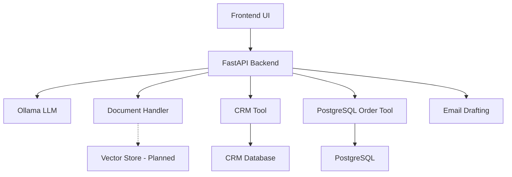

# Integrated AI Assistant

## 1. Project Purpose

The Integrated AI Assistant is an AI-powered application built using Python, FastAPI, Ollama, and PostgreSQL.

It helps users to:

- Upload documents and ask questions.
- Retrieve customer information from the CRM system.
- Check order status and customer orders.
- Generate email drafts using AI.
- Get responses through a conversational interface.

## 2. Features

- Document upload and question answering.
- CRM customer lookup by ID and email.
- PostgreSQL order information retrieval.
- AI-powered email drafting.
- Ollama LLM integration using Llama 3.2:1b.
- Automated unit and end-to-end testing.

## 3. Technology Stack

- Python
- FastAPI
- PostgreSQL
- Ollama (Llama 3.2:1b)
- SQLAlchemy
- Requests
- Pytest
- HTML, CSS and JavaScript

## 4. Project Structure

```text
Integrated_AI_Assistant/
│
├── app/
│   ├── main.py
│   └── tools.py
│
├── crm/
│   ├── main.py
│   └── database.py
│
├── orders/
│   └── tools.py
│
├── frontend/
│
├── uploads/
│
├── tests/
│   ├── test_crm.py
│   ├── test_orders.py
│   ├── test_scenarios.py
│   ├── test_report.py
│   └── test_results.csv
│
├── .env.example
├── .gitignore
├── requirements.txt
└── README.md
```

## 5. Architecture

The application follows a client-server architecture.

### Architecture Components

1. **Frontend UI:** Allows users to interact with the AI assistant.
2. **FastAPI Backend:** Handles user requests and connects application components.
3. **Ollama LLM:** Generates AI responses using Llama 3.2:1b.
4. **Document Handler:** Reads uploaded text documents and provides context for document questions.
5. **CRM Tool:** Retrieves customer information.
6. **PostgreSQL:** Stores and retrieves order information.
7. **Email Drafting:** Generates email drafts based on conversation history.
8. **Vector Store:** Planned component for embedding-based semantic document retrieval; not yet integrated into the current document-reading flow.

### Architecture Diagram



## 6. Setup Instructions

### Step 1: Clone the repository

```bash
git clone <your-repository-url>
cd Integrated_AI_Assistant
```

### Step 2: Create a virtual environment

```bash
python -m venv .venv
```

Activate on Windows:

```powershell
.venv\Scripts\activate
```

### Step 3: Install dependencies

```bash
pip install -r requirements.txt
```

### Step 4: Configure environment variables

Create a `.env` file using `.env.example` as a reference.

Configure your PostgreSQL database connection and other required settings using the variable names expected by the application.

Never commit passwords, API keys or `.env` files.

### Step 5: Start Ollama

Install Ollama and make sure it is running.

Pull the model:

```bash
ollama pull llama3.2:1b
```

### Step 6: Start CRM service

```bash
uvicorn crm.main:app --reload --port 8001
```

### Step 7: Start the main FastAPI application

Open another terminal and run:

```bash
uvicorn app.main:app --reload --port 8000
```

## 7. API Documentation

Open the following URL in your browser:

http://127.0.0.1:8000/docs

### Main API Endpoints

| Method | Endpoint | Purpose |
|---|---|---|
| POST | /chat | Chat with AI assistant |
| POST | /documents | Upload documents |
| POST | /draft-email | Generate email draft |

CRM service runs on port 8001.

## 8. Example Questions

Users can ask questions such as:

**Document Q&A**
- What are the working days?
- Explain the password reset procedure.

**CRM Tool**
- Find customer details for customer ID 1.
- Find customer information using an email address.

**Order Tool**
- What is the status of order 101?
- Show customer orders.

**Email Drafting**
- Draft a formal email based on our conversation.
- Create a friendly summary email.

**Refusal**
- Ask the assistant for information outside its available documents or business data and demonstrate its response when it cannot provide a supported answer.

## 9. Testing

Run unit tests:

```bash
python -m pytest tests/ -v
```

Run end-to-end tests:

```bash
python tests/test_report.py
```

Test results are saved in:

`tests/test_results.csv`

### Recorded Test Results

- Total E2E scenarios: 10
- Passed: 10
- Failed: 0
- CRM and order unit tests: 6 passed

All 10 E2E scenarios passed during the