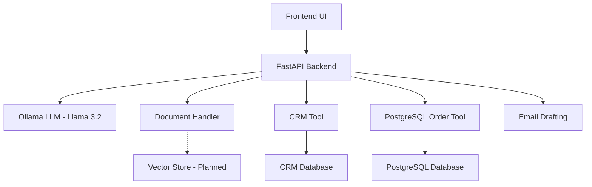

# Integrated AI Assistant – Architecture Diagram

## System Architecture

## Component Description

1. Frontend UI – User interaction.
2. FastAPI – Handles API requests.
3. Ollama – Generates AI responses.
4. Document Handler – Reads uploaded text documents.
5. CRM Tool – Retrieves customer information.
6. PostgreSQL – Retrieves order information.
7. Email Drafting – Generates email content.
8. Vector Store – Planned future enhancement, not currently integrated.

## Request Flow

1. User sends a question through the frontend.
2. FastAPI receives the request.
3. The backend identifies the required operation.
4. The relevant document, CRM or order component is called.
5. Ollama generates the response when required.
6. The response is returned to the frontend.
